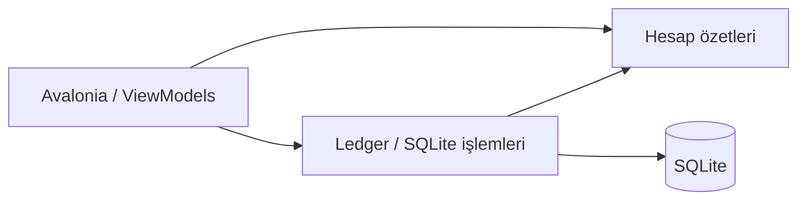

# CreditBook

Küçük işletmeler için çevrimdışı müşteri, borç ve tahsilat defteri.
.NET 10 + Avalonia masaüstü uygulaması; SQLite üzerinde yerel veri tutar.

## Çalıştırma

.NET 10 SDK gerekir.

```sh
dotnet restore CreditBook.slnx
dotnet run --project CreditBook.UI
```

Veritabanı, işletim sisteminin ApplicationData klasöründe
`CreditBook/creditbook.db` dosyasındadır. Geliştirmede farklı bir dosya kullanmak için
`CREDITBOOK_DB_PATH=/tam/yol/test.db` ortam değişkenini ayarlayın.

## Mimari



- `CreditBook.Core`: modeller, ödeme dağıtımı, doğrulama ve geçmişten hesaplanan puan.
  Avalonia ve EF Core bağımlılığı yoktur.
- `CreditBook.Storage`: işlem başına DbContext, atomik tahsilat, hesap sorguları,
  EF migrations ve SQLite backup. UI'ya takip edilen EF nesneleri vermez.
- `CreditBook.UI`: ekran durumu ve komutlar; Ledger kurucu üzerinden verilir.
  Veritabanı işlemleri arka planda yürür. Zamanlayıcı pencereyle başlayıp kapanır.
- `CreditBook.Tests`: gerçek geçici SQLite dosyaları ve ViewModel akışlarıyla
  doğrulama yapan, ek test paketi gerektirmeyen yürütülebilir test projesi.

## Hesap kuralları

- Borcun ilk tutarı sabittir. Tahsilatlar ve borçlara dağılımları ayrı tutulur.
- Hesap üzerinden tahsilat, tarih ve kayıt numarası sırasıyla en eski açık borçtan düşer.
  Borç satırındaki Kapat işlemi yalnızca o borcun kalanını tahsil eder.
- Fazla tahsilat ve ikiden fazla ondalık basamak reddedilir. Tutar girişinde
  Türkçe biçim kullanılır: `125,50`. Birim ₺.
- Kapatılan borçlar geçmişte kalır. Yanlış tahsilat geri alınabilir;
  geri alınan kayıt ve dağılımları silinmez, bakiyeye katkısı kaldırılır.
- Tahsilat geçmişi olmayan açık borç iptal edilebilir; kayıt silinmez.
  İşlem geçmişi olan müşteriler kaldırılamaz.
- Kişisel borç listesi kişiye aittir. Aile toplamı, kişi ve doğrudan bağlı
  yakınların ayrı hesaplarının toplamıdır; dolaylı akrabalık zinciri dahil değildir.
- Gecikme borç tarihinden 30 gün sonra başlar. Bildirimler açık borçlardan
  yeniden üretilir. Uygulama kapanınca kalıcı olarak kaybolmaz.
- Puan başlangıcı 100; açık gecikme -10, geç kapanan borç -25, zamanında kapanan
  borç +5. Toplam 0–100 aralığına alınır. Eski kapalı borçlarda ödeme tarihi
  bilinmediğinden puan etkisi hesaplanmaz. Tekrar Kapat puanı değiştirmez.

## Veritabanı geçişi ve yedek

Yeni veritabanlarında ve mevcut migration geçmişi olan dosyalarda EF migrations
uygulanır. Önceki EnsureCreated sürümünün tam olarak tanınan şemasında önce
`creditbook.db.before-ledger-<id>.bak` SQLite yedeği alınır; eski migration'lar
başlangıç kabul edilir ve yeni tablolar eklenir. Tanınmayan şemaya dokunulmaz.
Geçmiş sürümün sildiği ödemeler veya değiştirdiği ilk tutarlar yeniden üretilemez.

Yedek al düğmesi, açık veritabanını SQLite backup işlemiyle tutarlı bir dosyaya
kopyalar. Üzerine yazma reddedilir. Geri yükleme ekranı bu sürümde yoktur.

## Doğrulama

```sh
dotnet build CreditBook.slnx
dotnet run --project CreditBook.Tests
```

Testler kullanıcı veritabanına erişmez; geçici dosyalarda çalışır. Başarısızlıkta
sıfırdan farklı çıkış kodu döner. Paket erişimi kısıtlı ortamlarda `-m:1` ve
`--disable-build-servers` ile derleme yapılabilir.

## Sonraki aşama

Telefon erişimi henüz uygulanmadı. Hedef, bilgisayarda çevrimdışı kayıt ve
kimlik doğrulamalı bir sunucu üzerinden telefonda salt okunur son senkronize
hesap görüntüsü; son senkronizasyon saati görünür olacak. Sunucu, oturum yönetimi,
senkronizasyon ve kapsamlı görsel yenileme ayrı aşamalardır.
