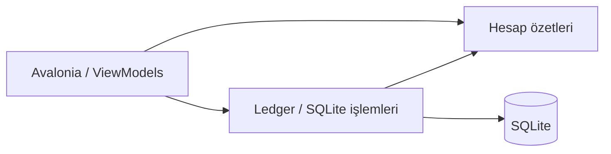

# CreditBook

Küçük işletmeler için çevrimdışı müşteri, borç ve tahsilat defteri.
.NET 10 + Avalonia masaüstü uygulaması; SQLite üzerinde yerel veri tutar.

## Çalıştırma

.NET 10 SDK gerekir.

```sh
dotnet restore CreditBook.slnx
dotnet run --project CreditBook.UI
```

Veritabanı, işletim sisteminin ApplicationData klasöründe
`CreditBook/creditbook.db` dosyasındadır. Geliştirmede farklı bir dosya kullanmak için
`CREDITBOOK_DB_PATH=/tam/yol/test.db` ortam değişkenini ayarlayın.

## Mimari



- `CreditBook.Core`: modeller, ödeme dağıtımı, doğrulama ve geçmişten hesaplanan puan.
  Avalonia ve EF Core bağımlılığı yoktur.
- `CreditBook.Storage`: işlem başına DbContext, atomik tahsilat, hesap sorguları,
  EF migrations ve SQLite backup. UI'ya takip edilen EF nesneleri vermez.
- `CreditBook.UI`: ekran durumu ve komutlar; Ledger kurucu üzerinden verilir.
  Veritabanı işlemleri arka planda yürür. Zamanlayıcı pencereyle başlayıp kapanır.
- `CreditBook.Tests`: gerçek geçici SQLite dosyaları ve ViewModel akışlarıyla
  doğrulama yapan yürütülebilir test projesi. Avalonia Headless ile ekran bağları da sınanır.

## Hesap kuralları

- Borcun ilk tutarı sabittir. Tahsilatlar ve borçlara dağılımları ayrı tutulur.
- Hesap üzerinden tahsilat, tarih ve kayıt numarası sırasıyla en eski açık borçtan düşer.
  Borç satırındaki Kapat işlemi yalnızca o borcun kalanını tahsil eder.
- Fazla tahsilat ve ikiden fazla ondalık basamak reddedilir. Tutar girişinde
  Türkçe biçim kullanılır: `125,50`. Birim ₺.
- Kapatılan borçlar geçmişte kalır. Yanlış tahsilat geri alınabilir;
  geri alınan kayıt ve dağılımları silinmez, bakiyeye katkısı kaldırılır.
- Tahsilat geçmişi olmayan açık borç iptal edilebilir; kayıt silinmez.
  İşlem geçmişi olan müşteriler kaldırılamaz.
- Müşteri adı, telefonu ve notu Müşteri sekmesinde düzenlenebilir; hesap kimliği ve hareketler korunur.
- Borç iptali ve tahsilatı geri alma gerekçe ister. Tahsilat geçmişinde borçlara dağılım görülür.
- Kişisel borç listesi kişiye aittir. Aile toplamı, kişi ve doğrudan bağlı
  yakınların ayrı hesaplarının toplamıdır; dolaylı akrabalık zinciri dahil değildir.
- Her borcun vadesi vardır; varsayılan borç tarihinden 30 gün sonrasıdır. Vade günü boyunca
  gecikme sayılmaz. Vade gerekçeyle değiştirilebilir; eski/yeni vade ve işlem zamanı korunur.
  Bildirimler açık borçlardan
  yeniden üretilir. Uygulama kapanınca kalıcı olarak kaybolmaz.
- Puan başlangıcı 100; açık gecikme -10, geç kapanan borç -25, zamanında kapanan
  borç +5. Toplam 0–100 aralığına alınır. Eski kapalı borçlarda ödeme tarihi
  bilinmediğinden puan etkisi hesaplanmaz. Tekrar Kapat puanı değiştirmez.

## Veritabanı geçişi ve yedek

Yeni veritabanlarında ve mevcut migration geçmişi olan dosyalarda EF migrations
uygulanır. Önceki EnsureCreated sürümünün tam olarak tanınan şemasında önce
`creditbook.db.before-ledger-<id>.bak` SQLite yedeği alınır; eski migration'lar
başlangıç kabul edilir ve yeni tablolar eklenir. Tanınmayan şemaya dokunulmaz.
Geçmiş sürümün sildiği ödemeler veya değiştirdiği ilk tutarlar yeniden üretilemez.

Yedek al düğmesi, açık veritabanını SQLite backup işlemiyle tutarlı bir dosyaya
kopyalar. Üzerine yazma reddedilir. **Yedek / Drive** penceresinden yerel klasör,
Google hesabı, kurtarma anahtarı ve geri yükleme yönetilir.

- Günlük ilk değişiklikten sonra yerel otomatik yedek alınır; 30 gün korunur. Aynı disk üzerindeki kopya disk kaybını karşılamaz.
- Google Drive'a varsayılan **3 saatte bir**, isteğe göre **2 saatte bir**, değişiklik varsa şifreli yedek gönderilir.
  Uygulama açık olmalıdır. İnternet kesilirse gönderim bekler; kayıt girişi devam eder.
- Drive başarı zamanı yalnız yükleme doğrulanınca ilerler. Son 48 saat sık kopyalar;
  ardından 30 günlük, 12 haftalık ve 12 aylık örnekler saklanır. Elle yedekler temizlenmez.
- Kurtarma anahtarı ve Google erişim bilgileri işletim sisteminin güvenli kasasında tutulur.
  Anahtarı bilgisayar dışında saklayın; Google hesabına erişim tek başına yedeği açmaz.
- Geri yükleme önce ayrı kopyada şema/bütünlük kontrolü yapar ve mevcut defterin güvenlik
  yedeğini alır; onaydan sonra defterin tamamını değiştirir. Kayıt birleştirme yapılmaz.
- Aynı defteri iki masaüstü oturumu eşzamanlı düzenleyemez. Drive, yedekleme/kurtarma içindir.

Google Cloud Desktop OAuth istemcisi oluşturulması ve tarayıcıda işletmenin hesabıyla izin
verilmesi gerekir. Kurulum ve yeni bilgisayardan kurtarma: [Google Drive kılavuzu](docs/google-drive-setup.md).
Gerçek hesap yetkilendirmesi yapılmadan canlı Drive yüklemesi doğrulanmış sayılmaz.

## Ekstre ve filtreler

Borç listesinde durum/tarih filtreleri ve tarih, vade, tutar sıralaması bulunur.
Müşteri listesi ada veya bakiyeye göre sıralanır. Filtreler toplam bakiyeyi değiştirmez.

Ekstre sekmesinde başlangıç/bitiş günleri dahil dönem seçilir. CSV ve PDF aynı hesaplanmış
hareketleri, dönem başı/kapanış bakiyesini gösterir. Yazdır / PDF aç, kaydedilen PDF'yi sistem
görüntüleyicisinde açar; oradan yazdırılır. Türkçe karakterler ve ₺ için açık lisanslı Noto Sans gömülür.

Geri alınan tahsilat ilk tarihte korunur; geri alma tarihinde ters hareket ve gerekçe görünür.
İptaller de iptal tarihinde işlenir. Eski kapalı/iptal borçların ödeme/iptal tarihi bilinmiyorsa
bu kayıtlar dönem hareketlerine alınmaz ve ekstrede geçmiş bakiyelerin eksik olabileceği belirtilir.
Mevcut borçlar migration sırasında borç tarihi +30 gün vadesiyle taşınır.

## Doğrulama

```sh
dotnet build CreditBook.slnx
dotnet run --project CreditBook.Tests
```

Testler kullanıcı veritabanına erişmez; geçici dosyalarda çalışır. Başarısızlıkta
sıfırdan farklı çıkış kodu döner. Paket erişimi kısıtlı ortamlarda `-m:1` ve
`--disable-build-servers` ile derleme yapılabilir.

## Sonraki aşama

Telefon erişimi henüz uygulanmadı. Hedef, bilgisayarda çevrimdışı kayıt ve
kimlik doğrulamalı bir sunucu üzerinden telefonda salt okunur son senkronize
hesap görüntüsü; son senkronizasyon saati görünür olacak. Sunucu, oturum yönetimi,
senkronizasyon ve kapsamlı görsel yenileme ayrı aşamalardır.
